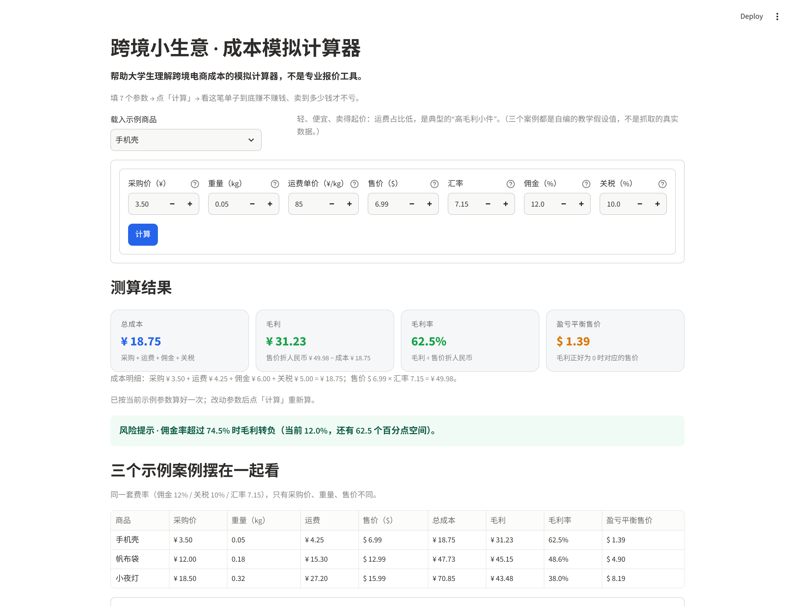
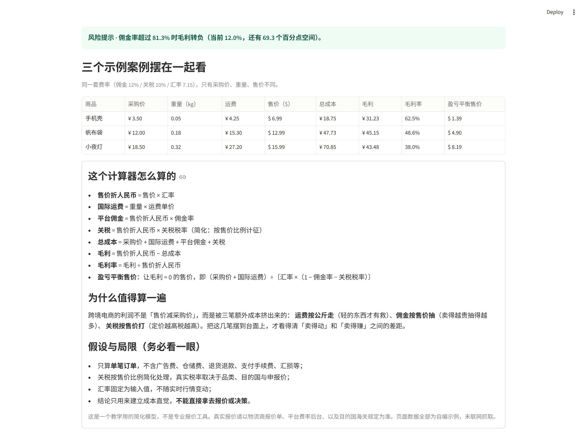

# 跨境小生意 · 成本模拟计算器

> 一个帮助大学生理解跨境电商成本的模拟计算器，**不是**专业报价工具。

## 作品概览

| 项 | 内容 |
| --- | --- |
| 作品定位 | 面向跨境电商入门学习者的成本测算教学工具：填参数、算一笔单子赚不赚钱、知道卖到多少钱才不亏 |
| 在线 Demo | （部署后填入 `https://xxx.streamlit.app`） |
| 源码仓库 | （上传后填入 GitHub 仓库链接） |
| 技术栈 | Python 3.12、Streamlit、Pandas；计算逻辑与页面分离（`calculator.py` 为纯函数模块，可独立测试） |
| 部署方式 | 本地双击 `启动计算器.bat` 即用；或托管到 Streamlit Community Cloud，公开链接访问 |

## 功能清单

1. **7 个输入参数**：采购价（¥）、重量（kg）、运费单价（元/kg）、售价（$）、汇率、佣金率、关税税率；
2. **4 张结果卡片**：总成本（¥）、毛利（¥）、毛利率、盈亏平衡售价（$），并附成本明细拆解；
3. **风险提示分级**：正常 / 偏薄 / 亏本三档，给出“佣金率超过 X% 时毛利转负”的临界值；
4. **三个自编案例**一键载入（手机壳、帆布袋、小夜灯），页面内并列对比三张单子的成本结构；
5. **说明区**：计算口径公式、假设与局限、免责声明，明确这是教学模拟而非报价工具。

输入 7 个参数 → 点「计算」→ 看到总成本、毛利、毛利率、盈亏平衡售价，外加一句风险提示。



---

## 文件结构

| 文件 | 作用 |
| --- | --- |
| `启动计算器.bat` | Windows 双击启动器：自动找 Python、缺依赖先装、启动服务并自动打开浏览器 |
| `app.py` | 页面本身：标题 → 一排 7 个输入框 →「计算」按钮 → 4 张结果卡片 → 风险提示 → 说明 |
| `calculator.py` | 纯计算逻辑 + 3 个示例案例，不依赖 Streamlit，可以单独测 |
| `requirements.txt` | 依赖（streamlit、pandas） |
| `.streamlit/config.toml` | 主题主色；关掉首次启动的邮箱登记提示和使用统计上报 |
| `scripts/verify_app.py` | 自检：算式恒等式、边界情况、页面渲染与点击 |
| `scripts/ui_check.py` | 真实浏览器验收（需要 playwright，可选） |

---

## 本地跑

### 方式一：双击启动（Windows，懒人模式）

直接双击 **`启动计算器.bat`** 就行：

1. 脚本按顺序找真正能跑的 Python：先试 `python`，再试 `py -3`，最后查常见安装目录；WindowsApps 里的商店占位程序会被跳过；
2. 缺 streamlit / pandas 时自动跑 `pip install -r requirements.txt`（首次约一两分钟，之后秒开）；
3. 启动服务并自动打开默认浏览器，地址是 http://localhost:8501；
4. 用完直接关掉那个黑色命令行窗口，服务就停止了。

> 前提：机器上装了 Python 3.9+，安装时勾选过 **Add Python to PATH**。没有 Python 的话脚本会给出安装指引。
> 这个 `.bat` 只在 Windows 上用；Mac / Linux 走下面的命令行方式。

### 方式二：命令行

```bash
pip install -r requirements.txt
streamlit run app.py
```

浏览器打开 http://localhost:8501 即可，Python 3.9+ 均可（推荐 3.12）。

### 常见问题：提示 `Python was not found`

如果黑窗口里出现下面这段：

> Python was not found; run without arguments to install from the Microsoft Store, or disable this shortcut from Settings > Apps > Advanced app settings > App execution aliases.

说明系统里的 `python` 是 **Microsoft Store 的占位程序**，不是真正的 Python（它能被 `where` 查到，但一运行就报这段）。装一个真正的 Python 即可，二选一：

- 命令行：`winget install Python.Python.3.12`（装完重开一次命令行/资源管理器再双击 bat）；
- 到 <https://www.python.org/downloads/> 下载安装包，安装第一屏勾选 **Add python.exe to PATH**。

装好后脚本会自动识别，不用改任何代码。

---

## 部署到 Streamlit Community Cloud

这一步需要**你自己的 GitHub 账号**授权，我没法代做，但整个过程就是点几下：

1. **建仓库**：在 GitHub 新建一个仓库（public 或 private 都可以），把 `app.py`、`calculator.py`、`requirements.txt`、`.streamlit/config.toml` 传上去。`启动计算器.bat` 只在本机双击用，Cloud 上不需要；`README.md`、`scripts/`、`preview-*.png` 也不是必需，传了不影响运行。
2. **登录** <https://share.streamlit.io>，用 GitHub 账号一键登录。
3. 点 **Create app / Deploy an app**，填三样东西：
   - Repository：刚建的那个仓库
   - Branch：`main`
   - Main file path：`app.py`
4. 展开 **Advanced settings** 可以指定 Python 版本（选 3.12）。这个应用不需要任何 secrets，不用填。
5. 点 **Deploy**，等 1～3 分钟构建完成，会拿到形如 `https://xxx.streamlit.app` 的公开链接。
6. 以后每次 `git push`，Cloud 会自动重新部署；应用一段时间没人访问会休眠，再次打开会自动唤醒。

常见卡点：`requirements.txt` 里的包名拼错、`Main file path` 写成 `app`（要带 `.py`）、文件放在子目录里导致路径找不到。代码全部用相对导入（`from calculator import ...`），只要三个 `.py` 在同一层目录就不会出问题。

---

## 计算口径

| 项 | 公式 |
| --- | --- |
| 售价折人民币 | 售价($) × 汇率 |
| 国际运费 | 重量(kg) × 运费单价(元/kg) |
| 平台佣金 | 售价折人民币 × 佣金率 |
| 关税 | 售价折人民币 × 关税税率（简化：按售价比例计征） |
| **总成本** | 采购价 + 国际运费 + 平台佣金 + 关税 |
| **毛利** | 售价折人民币 − 总成本 |
| **毛利率** | 毛利 ÷ 售价折人民币 |
| **盈亏平衡售价** | (采购价 + 国际运费) ÷〔汇率 ×（1 − 佣金率 − 关税税率）〕 |
| 风险提示 | 解毛利 = 0 得到的佣金率临界值 X，提示“佣金率超过 X% 时毛利转负” |

盈亏平衡售价的推导：设毛利为 0，则
`售价 × 汇率 × (1 − 佣金率 − 关税税率) = 采购价 + 国际运费`，把售价解出来就是它。

---

## 三个示例案例（自编数据，未抓取真实行情）

统一假设：汇率 7.15、平台佣金 12%、简化关税 10%、跨境运费 85 元/kg。

| 商品 | 采购价 | 重量 | 售价 | 总成本 | 毛利 | 毛利率 | 盈亏平衡售价 | 佣金率临界值 |
| --- | --- | --- | --- | --- | --- | --- | --- | --- |
| 手机壳 | ¥3.50 | 0.05 kg | $6.99 | ¥18.75 | ¥31.23 | 62.5% | $1.39 | 74.5% |
| 帆布袋 | ¥12.00 | 0.18 kg | $12.99 | ¥47.73 | ¥45.15 | 48.6% | $4.90 | 60.6% |
| 小夜灯 | ¥18.50 | 0.32 kg | $15.99 | ¥70.85 | ¥43.48 | 38.0% | $8.19 | 50.0% |

三个案例的差别只有采购价、重量、售价，正好演示一件事：**重量一上去，运费吃掉的比例就上去了**——小夜灯运费占总成本 38%，手机壳只有 23%。



---

## 已做的验证

```bash
python scripts/verify_app.py    # 算式 + 页面（Streamlit AppTest）
python scripts/ui_check.py      # 真实 Chrome 里点一遍（需先 pip install playwright，并确保本地服务在 8501 跑着）
```

`verify_app.py` 覆盖：

- 恒等式：成本四项相加 = 总成本；售价折人民币 − 总成本 = 毛利
- 回代：按盈亏平衡售价重算，毛利 ≈ 0；按临界佣金率重算，毛利 ≈ 0
- 边界：佣金 + 关税 ≥ 100% 时盈亏平衡售价无解；亏本单给出红色提示；售价 0 / 汇率 0 报错而不是除零
- 页面：7 个输入框、`计算` 按钮、4 张卡片、风险提示、三行案例对比表、说明区文案齐全
- 切换示例商品后参数整组变化并自动重算

`ui_check.py` 在真实浏览器里把售价改成 $12.5 再点「计算」，卡片显示毛利 ¥61.96 / 毛利率 69.3%，与算式结果一致。

启动器也实测过：从 `cmd` 跑 `启动计算器.bat`，服务正常起来、健康检查返回 `ok`，命令行不会卡在邮箱登记提示上（提示已在 `.streamlit/config.toml` 里关掉）。

---

## 已知局限（也是这个工具的教学边界）

- 只算**单笔订单**，不含广告费、仓储费、退货退款、支付手续费、汇损；
- 关税按售价比例简化，真实税率取决于品类、目的国与申报价；
- 汇率固定为输入值，不跟实时行情；
- 结论用来建立成本直觉，**不能直接拿去报价或决策**。

真实报价请以物流商报价单、平台费率后台、目的国海关规定为准。
